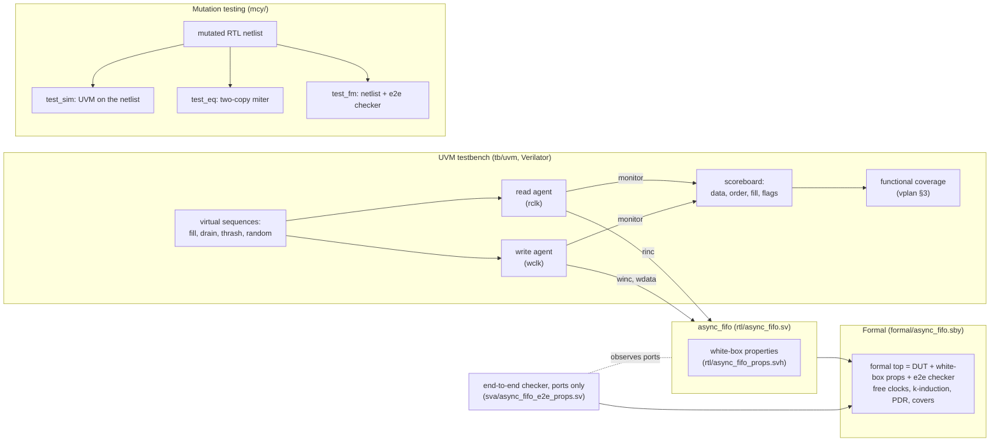

# Async FIFO: design verification

A parameterized asynchronous FIFO in the style of Cummings (SNUG 2002: gray-code pointers,
two-flop synchronizers, registered full and empty flags), verified with an open-source toolchain:

- **UVM** on Verilator: separate write and read agents on independent clocks, with a randomized clock ratio.
- **Functional coverage**, closed against a written verification plan and merged across seeds and clock ratios.
- **SVA**: white-box and end-to-end properties, each shown to fire when it is broken on purpose.
- **Formal**: SymbiYosys with two free clocks, proven unbounded with k-induction and cross-checked with PDR.
- **Planted bugs**: a detection matrix comparing simulation, assertions, formal and a structural CDC check.
- **MCY mutation coverage.**

The point is the evidence: every claim below comes from a saved result and a command that reproduces it.

[](https://github.com/KiritMand/Async-FIFO-DV-Project/actions/workflows/ci.yml)

## Results

The table below is generated by `make results` from the saved results. It is identical to the
summary in [ip/async_fifo/docs/results.md](ip/async_fifo/docs/results.md), which also has the
detail, the provenance of each number, and the reproduction commands. CI checks that the two
copies match.

<!-- results:begin (generated by make results; do not edit) -->

| ID | Criterion | Result | Status |
|---|---|---|---|
| SO-1 | 100% of the vplan coverage model, merged over every seed and clock ratio | **150/150** planned bins, **15/15** simulation covers (1,600 runs merged) | met (**UNKNOWN**) |
| SO-2 | Zero failures over N = 200 seeds per test, scoreboard and every assertion on | **1,600/1,600** runs pass (7 tests, 17 entries); 0/0 random reruns byte-identical | **NOT MET** (**UNKNOWN**) |
| SO-3 | Formal: every assertion proven unbounded and every cover reached, ASIZE 2 and 3 | k-induction **PASS** at ASIZE 2, 3; covers **22/22 at 2, 22/22 at 3**; PDR 2: PASS, 3: PASS | met (**UNKNOWN**) |
| SVA-neg | Every simulation assertion fires when its property is broken | **25/25** assertions fire when broken (7 `asm_`, 18 `ast_`); **8/8** concurrent twins fire with them; clean run quiet | met (**UNKNOWN**) |
| CDC | Structural CDC rules R1–R3 hold on the synthesized netlist | **0** violations, 1 waived, 2 multi-bit gray synchronizers | met (**UNKNOWN**) |
| Q-1 | Detection matrix for planted bugs: simulation vs. SVA vs. formal | 12 bugs; caught by simulation, UVM checks only **8**, simulation with every assertion **11**, formal spec bmc **11**, structural CDC **2**; by at least one method **12/12** | **PROBLEMS** (**UNKNOWN**) |
| Q-2 | MCY mutation score per method, every surviving mutant explained | seed 1: 299 non-equivalent, sim 100% / formal 100%, 0 survivors; probe `SVA=0` on seed 1: 298/299 detected; seed 2: 294 non-equivalent, sim 100% / formal 100%, 0 survivors | reported (**UNKNOWN**) |

Generated 2026-11-27T13:36 from the saved results of commit(s) unknown; **not current:** SO-1, SO-2, SO-3, SVA-neg, CDC, Q-1, Q-2 (see the provenance table in the results page).

Tools: not recorded.

<!-- results:end -->

## How it fits together



- The **end-to-end checker** sees only the FIFO's ports. The same module runs in the UVM bench,
  the negative-test bench, the formal top and the MCY harnesses.
- The **white-box properties** live inside the RTL behind an `ifdef`. Open-source formal tools have
  no `bind` or hierarchical references, so the properties cannot be attached from outside.
- **Formal** uses clocked immediate assertions only (DEC-002), because open-source SymbiYosys
  rejects concurrent SVA. Simulation also runs concurrent twins of the end-to-end assertions.

## Quick start

Requirements: Linux x86-64, `make`, `g++`, `perl`, Python ≥ 3.11 (standard library only), git.
Tools are pinned (versions: [docs/toolchain.md](docs/toolchain.md)):

```bash
# OSS CAD Suite 2026-11-21: Yosys, SymbiYosys, Verilator, MCY, solvers (about 750 MB)
mkdir -p ~/tools && cd ~/tools
curl -LO https://github.com/YosysHQ/oss-cad-suite-build/releases/download/2026-11-21/oss-cad-suite-linux-x64-20261121.tgz
echo "da62ff9cd16a69fc23607f3430459a3ca405561063e93910bf71d99012bb59e2  oss-cad-suite-linux-x64-20261121.tgz" | sha256sum -c
tar xzf oss-cad-suite-linux-x64-20261121.tgz            # creates ~/tools/oss-cad-suite

# UVM 2020-3.2, the release Verilator supports (only needed for the UVM flows)
git clone https://github.com/chipsalliance/uvm-verilator.git ~/tools/uvm-2020-3.2
git -C ~/tools/uvm-2020-3.2 checkout 1eab10a7995c7846dcad7305b995ddb265880433

# Then, in this repository:
make lint smoke formal
```

The Makefiles put `~/tools/oss-cad-suite/bin` on `PATH` themselves (`common/tools.mk`). To use
another location, pass `OSS_CAD_SUITE=<dir>`, or `OSS_CAD_SUITE=` to use whatever is already on
`PATH`. For UVM elsewhere, pass `UVM_HOME=<dir>/src`. `make help` lists every target and variable,
and every run prints a one-line command that reproduces it.

## Flows

| Command | What it does | Time |
|---|---|---|
| `make lint` | Verilator `-Wall` on the RTL and properties, Yosys formal parse; illegal sizes must be rejected | seconds |
| `make synth` | Yosys synthesis with `check -assert` | seconds |
| `make cdc` | Structural CDC rules on the netlist (no logic on a crossing, two stages, destination reset) | seconds |
| `make smoke` | Directed, non-UVM smoke test at two clock ratios | < 1 min |
| `make sim TEST=<t> SEED=<s>` | One UVM test (first build about 5 min) | seconds per run |
| `make regress [N=] [RECHECK=3]` | Every test × N seeds in parallel, merged coverage, random reruns compared byte for byte | about 10 min at N = 200 |
| `make sva-neg` | Breaks each simulation assertion on purpose and checks that it fires | minutes |
| `make formal TASK=prove ASIZE=2` | One SymbiYosys task (`bmc`, `prove`, `cover`, `pdr`, ...) | seconds to minutes |
| `make formal-signoff TIMEOUT=1800` | The SO-3 set at ASIZE 2 and 3, the assumption audit and cross-checks | about 1 h |
| `make bugs` | Planted-bug detection matrix → `docs/bug_matrix.md` | hours |
| `make mcy` | MCY mutation run → `docs/mutation_report.md` | about 1 h |
| `make results [STRICT=1]` | Builds `docs/results.md` and the table above from the saved results | seconds |
| `make evidence` | Reruns every flow behind the results page, then `make results STRICT=1` | hours |
| `make tools-smoke` | Reruns the toolchain capability experiments (required after a tool upgrade) | minutes |

Generated output goes to `out/` (ignored by git). Paths in `ip/async_fifo/docs/` are relative to `ip/async_fifo/`.

## Limitations

- **Metastability is not modeled.** Zero-delay RTL simulation and RTL formal both treat a
  synchronizer flop as ideal. A design with one synchronizer stage deleted (planted bug B08)
  passes every functional method, k-induction included. It is caught only by the structural CDC
  check and argued with MTBF numbers. Implementation still needs the CDC constraints in
  [ip/async_fifo/constraints/async_fifo.xdc](ip/async_fifo/constraints/async_fifo.xdc). That file
  is an example and has not been run through Vivado.
- **Resets.** Both resets are asserted together at power-up (A01) and never asserted again (A05,
  DEC-007). Reset synchronizers are the integrator's job (A02). Simulation holds the testbench to
  A02, but formal no longer assumes it, because the proof holds without it (DEC-012).
- **Formal runs at small sizes** (ASIZE 2 and 3, DSIZE 4), and MCY at ASIZE 2. The design is
  regular in ASIZE, but no proof covers the simulation size (ASIZE 4, DSIZE 8).
- **One open stimulus gap.** The first read-clock edge after reset release is never driven with a
  read (bug matrix, B12). An assertion catches B12 anyway. A stimulus fix is planned after v1.0.
- **One simulator.** Verilator only (DEC-001). The testbench is written to be simulator-neutral but
  has not been run on a commercial simulator.

## Next steps

Planned extensions, building on what is here:
- A general CDC lint.
- Metastability-aware formal, with nondeterministic first-stage capture.
- A reset-domain-crossing study that drops A01.
- FIFO variants: almost-full/empty, first-word fall-through, non-power-of-two depth.
- An AXI-Stream wrapper with reusable agents.
- FPGA bring-up with the constraints file.
- Gate-level simulation and RTL-versus-netlist equivalence.

New blocks go under `ip/<name>/` and reuse `common/`.

## Documentation

| Document | Contents |
|---|---|
| [ip/async_fifo/docs/spec.md](ip/async_fifo/docs/spec.md) | Specification: interface, flag timing, the pessimism bound K, reset rules |
| [ip/async_fifo/docs/vplan.md](ip/async_fifo/docs/vplan.md) | Verification plan: features, tests, coverage model, properties, assumption ledger, sign-off criteria |
| [ip/async_fifo/docs/results.md](ip/async_fifo/docs/results.md) | Generated results with provenance |
| [ip/async_fifo/docs/vplan_status.md](ip/async_fifo/docs/vplan_status.md) | Generated plan status: every coverage item and feature |
| [ip/async_fifo/docs/coverage_closure.md](ip/async_fifo/docs/coverage_closure.md) | How coverage was closed (holes found and fixed) |
| [ip/async_fifo/docs/formal_notes.md](ip/async_fifo/docs/formal_notes.md) | The formal model, induction invariants, comparison with ZipCPU's proof |
| [ip/async_fifo/docs/bug_matrix.md](ip/async_fifo/docs/bug_matrix.md) | Planted bugs: predictions, results, explanations |
| [ip/async_fifo/docs/mutation_report.md](ip/async_fifo/docs/mutation_report.md) | MCY: every mutant and what caught it |
| [ip/async_fifo/docs/interview_notes.md](ip/async_fifo/docs/interview_notes.md) | Short answers to the questions this project raises |
| [docs/decisions.md](docs/decisions.md) | Decision log (DEC-001 onward) |
| [docs/toolchain.md](docs/toolchain.md) | Pinned tools and the feature-by-tool experiments |
| [docs/progress.md](docs/progress.md) | Module-by-module log |
